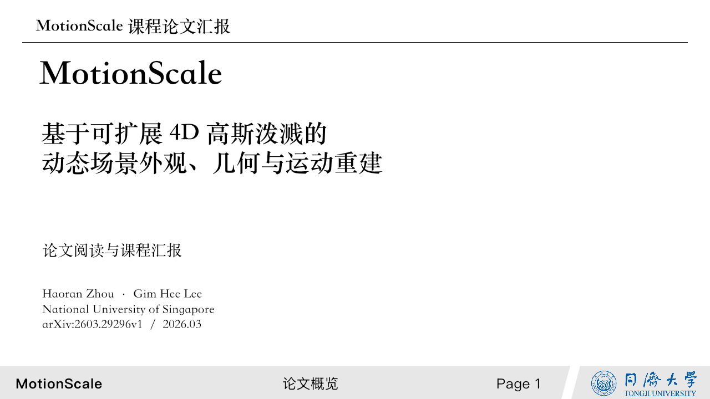
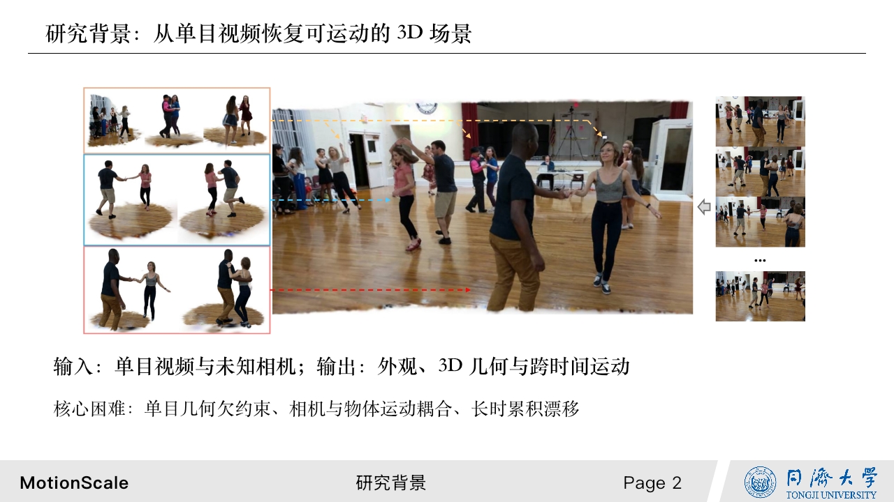

# Tongji Paper Report · 同济论文汇报

用于中文学术论文课程汇报的 Codex Skill。保留黑白宋体版式、完整页标题、浅灰页脚与同济校标，强调公式推导、论文原图表和证据分析。




## 使用

将本仓库完整目录放到你的 Codex 个人技能目录 `~/.codex/skills/artifact-template-tongji-paper-report`。若该目录已有个人版本，先备份再合并，不直接覆盖。

示例请求：

> 使用 $artifact-template-tongji-paper-report，根据这篇论文制作中文课程汇报。演讲约 18 分钟，重点讲方法、公式推导和实验依据。

> 在这份最新 PPT 上，只简化第 5 页的方法图，保留原风格，并做成可编辑图形。

默认新稿 20–22 页；用户给出的时长、页数与格式优先。现有 PPT 修改以当次提供的最新文件为准。

## 本次修订

- 明确新建、局部修改、解释和回退的不同处理方式。
- 把复杂图概括成可讲述的关系，使用原生图形、表格和公式。
- 保留论文原图与必要推导，避免套满彩色卡片。
- 局部修改后核对未改页，保留输入快照与可回退的成品。
- 区分提示词约束、程序校验、审计意见和真实验证结果。

## 完整内容

| 文件 | 用途 |
| --- | --- |
| `SKILL.md` | Skill 入口、适用范围和工作流 |
| `artifact-template.json` | 模板清单，所有资源使用相对路径 |
| `agents/openai.yaml` | Codex 展示与调用信息 |
| `assets/reference.pptx` | 保留的完整 22 页参考文件 |
| `assets/*.png` | 封面/正文预览与校标 |
| `references/` | 论文内容、版式、图解、修改与回退规范 |
| `scripts/tongji-chrome.mjs` | 使用兼容 Artifact Tool API 添加标准页眉页脚 |
| `scripts/verify_pptx_edit.py` | 只读检查同页序 PPTX 的局部编辑范围 |

参考 PPT 中的 MotionScale 内容是已有课件示例，不是新论文的通用事实。新稿必须替换论文名称、图表、公式、备注和出处。

## 依赖与验证

正常使用需要能够读写和渲染 PPTX 的环境。优先使用当前可用的 Presentations、PDF 工作流；需要 Artifact Tool 的 helper 不代表 Skill 自带该运行时。基础检查脚本仅需 Python 3.9 或更新版本的标准库，不要求 API 密钥。

```sh
python3 scripts/verify_pptx_edit.py before.pptx after.pptx --changed-slides 5 --native-slides 5
python3 -m unittest discover -s tests -v
```

脚本严格比较未改页的 XML、备注和关联资源，可能把软件自动规范化也报告成差异；应查看后再判断。它不能替代渲染检查、数学核对和在演示软件中的编辑检查。页数或页序改变需要另建映射。

## 素材说明

这是个人课程汇报工作流，不是同济大学官方发布的模板。校标、论文原图和第三方内容归各自权利人；本仓库不授予这些素材的额外使用权。来源说明见 [NOTICE.md](NOTICE.md)。
